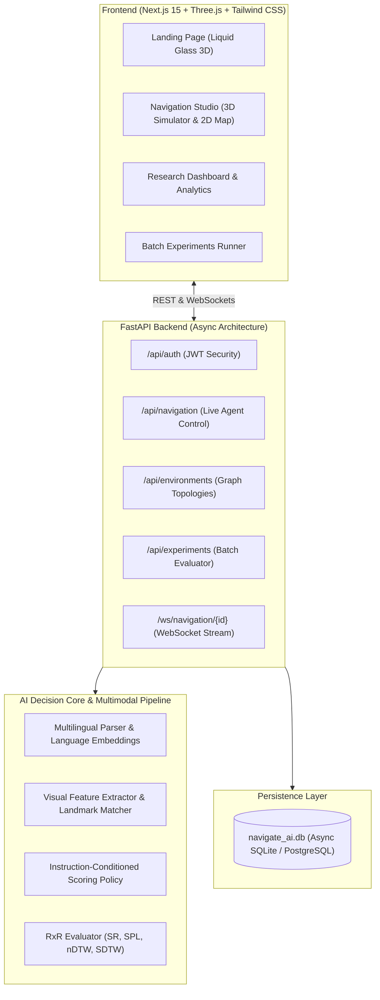

# NAVIGATE AI | Multilingual Vision-and-Language Navigation Decision Agent

> **"Language is the destination. Intelligence is the path."**  
> *A research-grade AI navigation system inspired by the Google Research Room-Across-Room (RxR) Challenge.*

[](https://opensource.org/licenses/MIT)
[](https://python.org)
[](https://fastapi.tiangolo.com)
[](https://nextjs.org)
[](https://pytorch.org)
[](https://threejs.org)

---

## 🧭 Executive Overview

**Navigate AI** is a complete, production-ready, research-grade autonomous indoor navigation platform. Built upon the principles of the **Google Research Room-Across-Room (RxR)** multilingual benchmark, Navigate AI accepts natural-language navigation instructions across multiple languages (**English, Hindi, and Spanish**), perceives complex 3D indoor environments, constructs topological state spaces, and executes sequential, instruction-conditioned decision policies with calibrated uncertainty estimation.

### Key Capabilities
- **Multilingual Semantic Parsing**: Joint rule-based semantic analyzer with multilingual embeddings (`paraphrase-multilingual-MiniLM-L12-v2`) extracting target goals, sequential waypoints, landmark references, and directional constraints.
- **Topological State-Space Navigation**: Continuous 3D spatial environments mapped into NetworkX navigation connectivity graphs with 360° panoramic panoramic viewpoints (Front $0^\circ$, Right $90^\circ$, Back $180^\circ$, Left $270^\circ$).
- **Instruction-Conditioned Policy**: Multi-criteria action scoring integrating landmark grounding, path progression, directional alignment, movement cost, and visited-node loop penalties.
- **Calibrated Uncertainty & Failure Detection**: Dynamic entropy calculation, candidate margin ambiguity, missing landmark warnings, and automatic replanning.
- **Evaluation Suite**: Strict RxR research metrics: **Success Rate (SR)**, **Success weighted by Path Length (SPL)**, **Navigation Error (NE)**, **Normalized Dynamic Time Warping (nDTW)**, and **Success-weighted nDTW (SDTW)**.
- **Interactive 3D Navigation Studio**: Liquid glass interface featuring a Three.js / React Three Fiber 3D simulator, synchronized 2D top-down SVG map, step-by-step scrubber replay, real-time WebSocket telemetry, and human-in-the-loop intervention.

---

## 🏛 Architecture Diagram



---

## ⚡ Quick Start (Local Setup)

The system works **100% locally out-of-the-box** with zero mandatory external API keys or cloud dependencies.

### Prerequisites
- Python 3.11+
- Node.js 18+ & npm
- Git

### 1. Clone & Setup Backend

```bash
cd backend

# Create virtual environment
python -m venv venv
# On Windows:
venv\Scripts\activate
# On Linux/macOS:
source venv/bin/activate

# Install dependencies
pip install -r requirements.txt

# Start backend server
uvicorn app.main:app --host 127.0.0.1 --port 8000 --reload
```
*The database (`navigate_ai.db`) will automatically initialize and seed default demonstration environments, test instructions, and a researcher account.*

### 2. Setup & Run Frontend

```bash
cd frontend

# Install dependencies
npm install

# Run development server
npm run dev
```

Open **`http://localhost:3000`** in your browser.

### 3. Demo Credentials

The platform includes a pre-seeded researcher account:
- **Email**: `researcher@navigate.ai`
- **Password**: `Researcher123!`
*(Or click the "Auto-Fill Demo Researcher Account" button on the login screen).*

---

## 🧪 Built-in Demonstration Environments

Navigate AI comes pre-loaded with **5 distinct indoor environments**:

| Environment ID | Name | Rooms / Nodes | Key Landmarks | Primary Topology |
|---|---|---|---|---|
| `office_floor` | Tech Hub Research Office | 10 nodes | Server room, reception, coffee lounge, boardroom | Dual-corridor ring |
| `residential_apartment` | Modern Luxury Loft | 8 nodes | Kitchen island, fireplace, balcony, walk-in closet | Open-plan branching |
| `hotel_corridor` | Grand Horizon Hotel Floor | 12 nodes | Elevators, ice machine, fire exit, suites | Linear corridor |
| `university_building` | Science & Engineering Wing | 11 nodes | Robotics lab, auditorium, library, faculty offices | Cross-hub cluster |
| `multi_room_indoor` | Complex Indoor Facility | 14 nodes | Operations desk, atrium, storage, executive terrace | Multi-floor loop |

---

## 🌐 Multilingual Instruction Demonstrations

The system includes 24+ validated instructions across English, Hindi, and Spanish:

### English Examples
- *"Walk past the reception desk, turn left at the hallway, and enter the main conference room."*
- *"Go straight past the elevator lobby, take a right towards the coffee lounge, and stop near the glass door."*

### Hindi Examples (हिंदी)
- *"रिसेप्शन से आगे बढ़ें, गलियारे से बाएं मुड़ें और मुख्य सम्मेलन कक्ष में प्रवेश करें।"*
- *"रसोई से निकलें, लिविंग रूम के पार जाएं और बालकनी के पास रुकें।"*

### Spanish Examples (Español)
- *"Sal de la recepción, gira a la izquierda en el pasillo y entra a la sala de conferencias."*
- *"Avanza hacia la sala de estar pasando por la cocina y detente junto al balcón."*

---

## 📐 Mathematical Formulation & Decision Scoring

The agent evaluates every candidate navigable action $a \in \mathcal{A}(s_t)$ using a multi-criteria utility function:

$$\text{Score}(a) = w_1 \cdot S_{\text{inst}}(a, I) + w_2 \cdot S_{\text{lm}}(a, \mathcal{L}) + w_3 \cdot S_{\text{prog}}(a, g) - w_4 \cdot \text{Cost}(a) - w_5 \cdot \text{Penalty}_{\text{loop}}(a)$$

Where:
- $S_{\text{inst}}$: Semantic alignment between action direction and instruction constraints.
- $S_{\text{lm}}$: Landmark verification score matching visual observation against target landmarks:
  $$S_{\text{lm}} = \max_{l \in \mathcal{L}_{obs}} \frac{\mathbf{e}_l \cdot \mathbf{e}_{ref}}{\|\mathbf{e}_l\| \|\mathbf{e}_{ref}\|}$$
- $S_{\text{prog}}$: Relative geodesic distance reduction toward the target goal $g$:
  $$S_{\text{prog}} = \frac{d_G(s_t, g) - d_G(s', g)}{d_G(s_t, g) + \epsilon}$$
- $\text{Penalty}_{\text{loop}}$: Visited node penalty suppressing cyclic oscillations:
  $$\text{Penalty}_{\text{loop}}(a) = \alpha \cdot \text{visit\_count}(s')$$

### Uncertainty & Ambiguity Quantification
- **Candidate Margin Ambiguity**:
  $$\text{Ambiguity}(s_t) = 1.0 - \left(P(a_1) - P(a_2)\right)$$
- **Entropy-based Confidence**:
  $$\mathcal{H}(P) = -\sum_{i=1}^K P(a_i) \log_2 P(a_i), \quad \text{Confidence} = 1.0 - \frac{\mathcal{H}(P)}{\log_2 K}$$

---

## 📊 RxR Evaluation Benchmark

Navigate AI implements the exact benchmark metrics specified by Google Research:

1. **Success Rate (SR)**: $\frac{1}{N} \sum_{i=1}^N \mathbb{I}(d(v_T^i, g^i) \le 3.0\text{m})$
2. **Success weighted by Path Length (SPL)**: $\frac{1}{N} \sum_{i=1}^N S_i \frac{L_i}{\max(P_i, L_i)}$
3. **Navigation Error (NE)**: Geodesic or Euclidean distance between final location and target node.
4. **Normalized Dynamic Time Warping (nDTW)**: Path alignment fidelity metric penalizing deviations from ground-truth trajectories.
5. **Success-weighted nDTW (SDTW)**: $\text{SDTW} = S_i \times \text{nDTW}$.

---

## 🔌 API Endpoints Summary

| Method | Endpoint | Description |
|---|---|---|
| `GET` | `/health` | System health check and model status |
| `POST` | `/api/auth/register` | Register new researcher account |
| `POST` | `/api/auth/login` | Authenticate and obtain JWT access token |
| `GET` | `/api/environments` | List all available 3D topological environments |
| `GET` | `/api/environments/{id}` | Retrieve detailed room graph, nodes, and edges |
| `POST` | `/api/environments` | Upload and register custom environment JSON |
| `POST` | `/api/navigation/start` | Initialize navigation episode with instruction |
| `POST` | `/api/navigation/step` | Advance autonomous agent by one step |
| `POST` | `/api/navigation/intervene` | Human-in-the-loop manual action override |
| `GET` | `/api/navigation/episodes` | Query historical navigation runs with metrics |
| `GET` | `/api/navigation/episodes/{id}` | Inspect trajectory snapshots and step replay |
| `POST` | `/api/experiments/run` | Execute batch evaluation suite |
| `WS` | `/ws/navigation/{id}` | Live bi-directional agent telemetry stream |

*Interactive Swagger documentation is available at `http://127.0.0.1:8000/docs`.*

---

## 🛠 Running Automated Tests

Run the comprehensive pytest suite verifying AI policy logic, graph operations, parser multilingual support, and API endpoints:

```bash
cd backend
pytest -v
```

Expected output:
```text
tests/test_navigation_system.py::test_environment_graph_loading PASSED
tests/test_navigation_system.py::test_instruction_parser_multilingual PASSED
tests/test_navigation_system.py::test_visual_encoder_landmarks PASSED
tests/test_navigation_system.py::test_navigation_policy_scoring PASSED
tests/test_navigation_system.py::test_evaluator_metrics PASSED
tests/test_navigation_system.py::test_navigation_service_flow PASSED
tests/test_api_endpoints.py::test_health_endpoint PASSED
tests/test_api_endpoints.py::test_auth_flow PASSED
tests/test_api_endpoints.py::test_environments_endpoints PASSED
tests/test_api_endpoints.py::test_navigation_start_and_step PASSED
tests/test_api_endpoints.py::test_human_intervention PASSED
tests/test_api_endpoints.py::test_models_status_endpoint PASSED
tests/test_api_endpoints.py::test_experiments_batch_run PASSED
====== 13 passed in 2.65s ======
```

---

## 📄 License
This project is licensed under the MIT License - see the LICENSE file for details. Built for researchers, engineers, and multimodal AI practitioners following the Google Research RxR benchmark.
