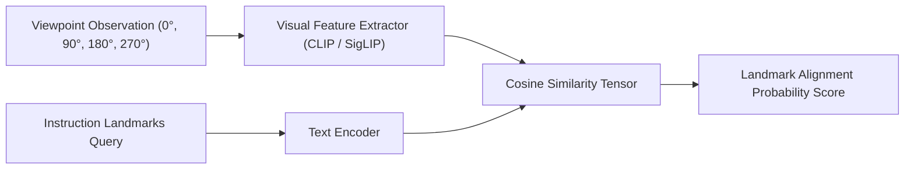

# Navigate AI — AI Model & Multimodal Pipeline

## Overview

Navigate AI utilizes an integrated multimodal perception and language understanding model architecture designed for sequential decision-making in 3D indoor environments.

---

## 1. Multilingual Instruction Understanding

The system takes natural-language instructions in English, Hindi, Spanish, and other languages:

- **English Example**: `"Walk straight forward past the reception desk, proceed through the central hub, and enter the executive office at the end of the hall."`
- **Hindi Example**: `"रिसेप्शन डेस्क से सीधे आगे बढ़ें, गलियारे से होते हुए केंद्रीय हब को पार करें और अंत में कार्यकारी कार्यालय में प्रवेश करें।"`

### 1.1 Instruction Parser & Semantic Representation
The parser extracts:
1. `language`: ISO language code (`en`, `hi`, `es`, etc.)
2. `initial_direction`: Directional orientation (`forward`, `turn_left`, `turn_right`, `turn_around`)
3. `landmarks`: Target visual and topological entities (`reception_desk`, `staircase`, `server_room`, `cafeteria`)
4. `spatial_constraints`: Relational ordering (`after`, `beside`, `past`, `at_end`)
5. `destination`: Inferred final goal node
6. `ordered_waypoints`: Intermediate milestones required to reach the destination

### 1.2 Multilingual Embeddings
- **Primary Model**: `sentence-transformers/paraphrase-multilingual-MiniLM-L12-v2` (384-dimensional dense semantic vectors).
- **Fast Local Fallback**: Character n-gram TF-IDF vectorization ensuring 100% offline functionality without external downloads.

---

## 2. Visual-Language Perception Engine

The perception layer inspects panoramic viewpoint observations:

- **Feature Dimensionality**: 512-dimensional normalized embeddings.
- **Viewpoint Coverage**: 4 orthogonal azimuth headings ($0^\circ, 90^\circ, 180^\circ, 270^\circ$).
- **Structured Vision Fallback**: When real Matterport3D panoramas are unavailable, structured landmark embeddings are generated and explicitly identified.

---

## 3. Decision-Making Policy

The hybrid policy combines semantic understanding with topological constraints:

$$\text{Score}(a) = 0.35 \cdot S_{\text{inst}}(a) + 0.35 \cdot S_{\text{lm}}(a) + 0.30 \cdot S_{\text{prog}}(a) - \text{Cost}(a) - \text{Penalty}_{\text{loop}}(a)$$

Every decision produces a human-readable explanation grounded in actual feature scores.
