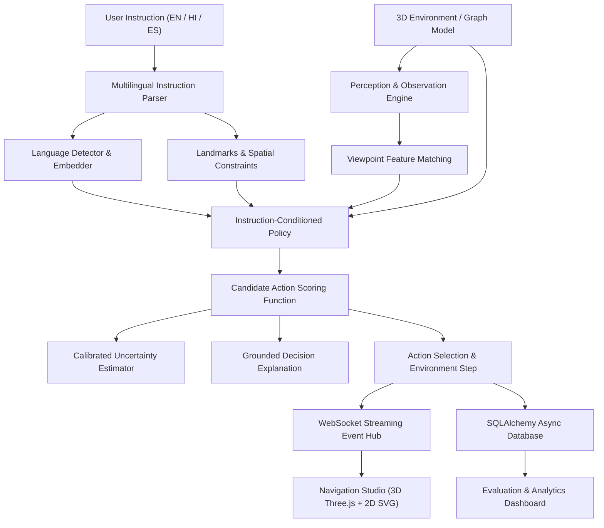

# Navigate AI — System Architecture Specification

## 1. Executive Summary

Navigate AI is an autonomous, multilingual Vision-and-Language Navigation (VLN) Decision Agent and research platform inspired by the Google Research Room-Across-Room (RxR) challenge. The system enables autonomous agents to interpret natural-language directions in English, Hindi, and Spanish, perceive 3D environments, perform topological graph reasoning, evaluate candidate action probabilities, and reach designated goal destinations.

---

## 2. Component Taxonomy

### 2.1 Instruction Understanding Subsystem
- **Language Detection & Normalization**: Automatically identifies instruction language (supports ISO-639-1 `en`, `hi`, `es`, `de`, `fr`, `zh`).
- **Linguistic Extraction**: Extracts directional cues (`forward`, `turn_left`, `turn_right`, `turn_around`), visible landmarks (`reception`, `staircase`, `kitchen`, `vault`), spatial constraints (`after`, `beside`, `past`), and intermediate waypoints.
- **Multilingual Semantic Embeddings**: Employs `paraphrase-multilingual-MiniLM-L12-v2` or character n-gram semantic vectorization.

### 2.2 Environmental State-Space Graph
- **Topological Representation**: Implemented as directed NetworkX graphs where nodes denote accessible rooms, corridors, and viewpoints $v \in \mathcal{V}$, and edges $e = (u, v) \in \mathcal{E}$ denote navigable traversal corridors with physical distance and compass headings.
- **Ground-Truth Geodesics**: Employs Dijkstra and A* pathfinding for optimal reference distance estimation.

### 2.3 Visual Perception Backbone
- **Viewpoint Observations**: Generates multi-angle perceptual observations at $0^\circ, 90^\circ, 180^\circ, 270^\circ$.
- **Visual-Semantic Matching**: Computes cosine similarity between observed visual landmarks and linguistic goal targets.

### 2.4 Hybrid Action Policy
The decision engine scores each candidate action $a \in \mathcal{A}(v_t)$ transitioning from current node $v_t$ to neighbor $v'$:

$$\text{Score}(a) = w_{\text{inst}} \cdot S_{\text{inst}}(a) + w_{\text{lm}} \cdot S_{\text{lm}}(a) + w_{\text{prog}} \cdot S_{\text{prog}}(a) - \text{Cost}(a) - \text{Penalty}_{\text{loop}}(a)$$

- $S_{\text{inst}}(a)$: Directional orientation match with parsed command.
- $S_{\text{lm}}(a)$: Visual-semantic alignment with detected landmark entities.
- $S_{\text{prog}}(a)$: Graph distance reduction towards target waypoint: $d(v_t, g) - d(v', g)$.
- $\text{Penalty}_{\text{loop}}(a)$: History penalty for recently visited nodes ($0.60 - 0.80$).

### 2.5 Uncertainty Estimation
Calculates confidence based on:
1. Candidate margin: $\Delta = S(a_1) - S(a_2)$. If $\Delta < 0.08$, flags action ambiguity.
2. Missing landmark evidence: Verifies that requested landmarks exist in reachable subgraphs.
3. Graph reachability: Identifies unreachable destinations and prompts replanning.
